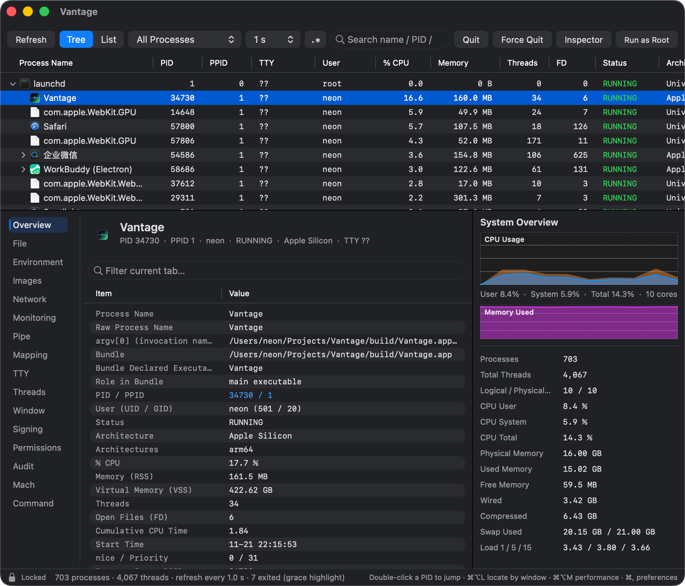
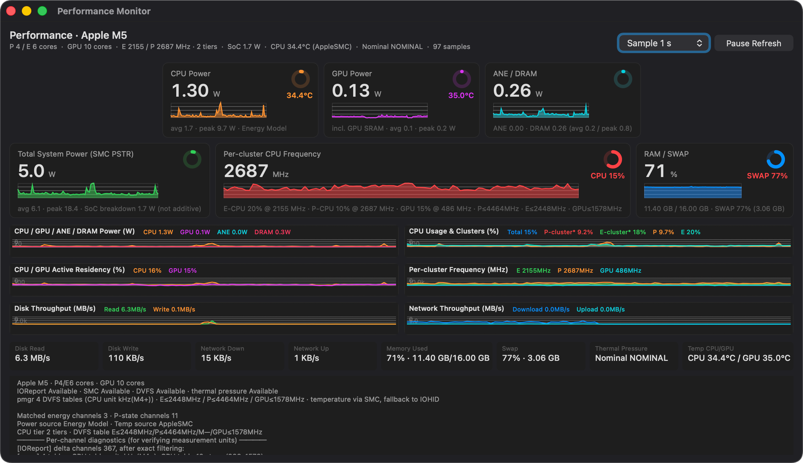
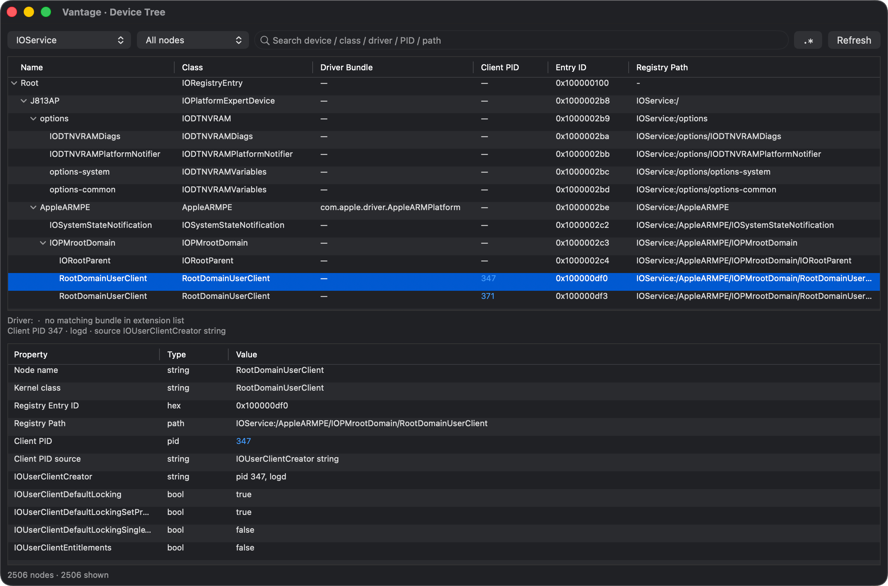
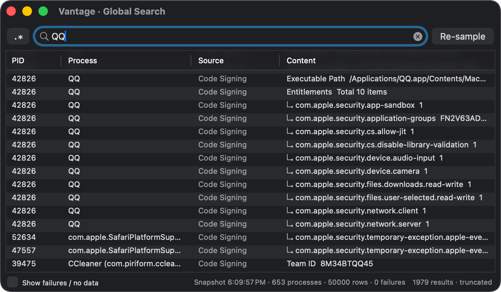
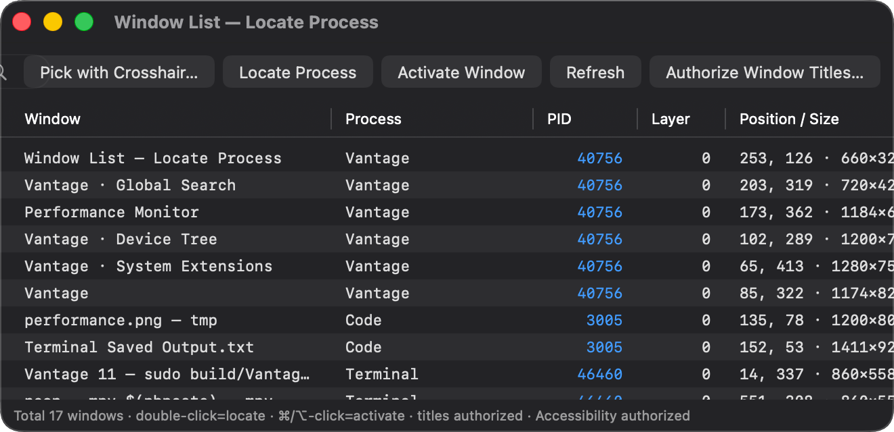

# Vantage


**A native macOS process manager and system monitor**, written in **C** (data collection)
and **Swift / AppKit** (UI). Inspired by Activity Monitor (Apple) and System Informer's
window-picking interaction.

[简体中文说明](README.zh-Hans.md) · [Implementation notes](docs/IMPLEMENTATION.md) · [Compatibility notes](docs/COMPATIBILITY.md)



*Process tree with 14 sortable columns, an expanded app bundle, and the inspector's
Overview tab showing the raw executable name alongside the localized app name.*

---

## Why Vantage

Most macOS process tools either stop at `ps`-level columns or require `sudo powermetrics`
to see power and frequency data. Vantage goes further while staying a **single `.app`
you can build locally — or download as a DMG from Releases**:

- **No root, no `powermetrics`, no Electron.** Everything is collected through macOS SDK
  interfaces — `sysctl`, `libproc`, Mach, IOKit, CoreGraphics, Security.framework.
  Power / temperature / DVFS data comes from optionally-loaded private interfaces
  (`libIOReport`, `AppleSMC`, IOHIDEventSystem), resolved at runtime with `dlopen`/`dlsym`
  and gracefully degraded when unavailable.
- **Works under SIP.** `task_for_pid` on protected processes is blocked by SIP regardless
  of UID, so Vantage does not depend on a task port: VM regions, images, audit token,
  CS flags, sockets, pipes, TTY and code signing all have task-port-free paths.
- **Inspector-grade detail**, lazily loaded per tab and cached, so selecting a heavy app
  never freezes the UI.

## Highlights

| Area | What you get |
|---|---|
| Process list | Tree / flat view, 14 sortable columns with a three-state header cycle, live refresh (0.5–5 s), filters, regex search, localized names plus raw executable names, optional argv[0] annotation when it differs from the binary, highlighted exited processes |
| Inspector | 16 tabs — Overview, Files, Environment, Images, Network, Monitoring, Pipe peers, VM Regions, TTY, Threads, Windows, Signature, Permissions, Audit, Mach, Command — each independently filterable (the filter field is collapsed by default; ⌘F reveals and focuses it); right-click any path cell for Reveal in Finder / Copy Path |
| Signals | Right-click menu and main menu with 31 Darwin signals, configurable visibility (12 shown by default), confirmation policies, pause/resume, `sample` |
| Performance (⌘⌥M) | CPU/GPU/ANE/DRAM power, whole-machine power (SMC `PSTR`), CPU/GPU temperature, per-cluster frequency from P-state residency, CPU/GPU activity, disk and network throughput, thermal pressure — all with a per-channel diagnostic readout |
| Global search (⌘⇧F) | Takes a frozen process snapshot, then samples every process across all tabs; results link back to the exact tab and row. Snapshots export to gzipped JSON, load back for offline search / sharing, and diff line by line against a saved baseline |
| Device tree (⌘⌥B) | IORegistry browser across 7 planes with driver bundle lookup, `IOUserClientCreator` client PIDs and full property tables |
| Extensions (⌘⌥E) | `.kext` / `.dext` / `.systemextension` / `.appex` inventory, load state, `IOKitPersonalities` and Team ID |
| Window tools | Crosshair window → process lookup (⌘⌥L), global window list, double-click a window to activate it (Accessibility), PID double-click jumps between processes and tabs |
| Launch Items (⌘⌥J) | Every launchd job on the machine: `LaunchDaemons` / `LaunchAgents` from `/System`, `/Library` and each user's `~/Library`, plus legacy `StartupItems`. Columns show scope, label, type, program, trigger (`RunAtLoad` / `KeepAlive` / `StartInterval` …), live state (running with PID, loaded, disabled, not loaded) and path; selecting a row shows the whole plist underneath — full `ProgramArguments`, `KeepAlive` conditions, Mach service names, run-as user, log paths — so you can tell what an item actually does. Right-click a third-party item to load / unload / enable / disable it (root via Authorization Services); Apple's own entries stay read-only |
| System Information (⌘⌥I) | Host name, model, chip, physical memory, macOS/kernel version and uptime, plus the SIP active-config bitmask read straight from the kernel (`csr_get_active_config`, with a file-flag probe fallback) — filesystem protections, debugging restrictions and `task_for_pid` |
| Network (⌘⌥N) | Interfaces in ifconfig terms (state / flags / MTU / MAC / IPv4 / IPv6) with a per-interface address table, plus the routing table (route / netstat terms); bring links up or down, set MTU, add or delete IPv4/IPv6 addresses and routes (including default) |
| Elevation | A Run as Root button relaunches the app as root through Authorization Services (the system password dialog — no sudo); permission failures show an inline bar with a one-click elevate action instead of a modal alert. A lock in the bottom-left corner works like any system utility: click it to pre-authorize once (later privileged actions stop prompting), click again to revoke. A root instance that was elevated from a user account offers Run as User to drop back with `setgid` / `initgroups` / `setuid` |
| Touch ID elevation (optional) | Off by default. Turning it on installs a root LaunchDaemon helper (one password prompt) so later escalations ask for Touch ID instead of a password. The helper only accepts a client that is the **console user with admin rights** *and* whose code-signing cdhash equals its own (non-admin and non-desktop clients are refused, so the helper cannot be abused to elevate), and only runs an allowlist of tools (`ifconfig`, `route`, `launchctl`) plus the app's hidden `--tcc-write` mode. Turn it off to bootout and delete the helper |
| MCP server | Standalone `vantage-mcp` executable (stdio JSON-RPC): list processes, dump inspector pages, send signals, read interfaces/routes and system stats — works without the GUI running |
| CLI | `vantage` (bundled at `Vantage.app/Contents/MacOS/bin/vantage`): `list` / `info` / `detail` / `tree` / `stats` / `net` / `signal`, aligned tables for humans and `--json` for scripts — no GUI needed, same collectors as the inspector |
| AppleScript | `Resources/Vantage.sdef`: `list processes`, `process info`, `quit process`, `list interfaces`, `list routes` |
| Exited processes | Still open the inspector during the grace window: overview/command replay the last snapshot, lazy tabs replay only what had been collected before exit |
| Threads tab | One row per thread — TID, name, run state, CPU, user/system time, priority and scheduling policy (PROC_PIDLISTTHREADS + PROC_PIDTHREADINFO); collected only when the tab is opened |
| Permissions tab | Three sources in one table: entitlements from the code signature, TCC grants from the user and system TCC.db (status shown as enabled/disabled, with reason and modification date; reading requires Full Disk Access), plus SIP and task-port capability. When SIP filesystem protections are off, right-click a TCC row to grant or revoke it (root via Authorization Services); when a task port is obtainable, task-level memory/CPU/policy rows are added |
| Customization | Preferences (⌘,) with seven panes (General / Interface / Data & Cache / Search / Privilege / Colors / Signals) for collection limits, cache TTLs, refresh intervals, default view, signals, 11 colors and 5 presets; inspector and settings tab bars can be Auto-wrap, Fixed N per row, or a scrollable left column; dark mode, i18n (a language change restarts once so nothing stays half-translated), ⌘C row copy, ⌘/⌥-click equivalents |

See [docs/IMPLEMENTATION.md](docs/IMPLEMENTATION.md) for the full feature matrix and
data-source details.

## Screenshots

### Performance monitor (⌘⌥M)



*CPU/GPU/ANE/DRAM power, whole-machine power (SMC `PSTR`), CPU/GPU temperature,
per-cluster frequency from P-state residency, disk and network throughput, and the
per-channel diagnostics readout used to verify measurement units.*

### Device tree (⌘⌥B)



*IORegistry browser with a `RootDomainUserClient` node selected: driver bundle lookup,
`IOUserClientCreator` client PID, and the full property table.*

### Global search (⌘⇧F)



*Search over a frozen snapshot of every process and every inspector tab; results jump
back to the exact tab and row.*

### Window list



*All on-screen windows with owner PID, layer and bounds. Double-click locates the
process; ⌘/⌥-click activates that particular window.*

## Requirements

- **macOS 12 (Monterey) or later** — Apple Silicon recommended for power / DVFS data
- **Xcode Command Line Tools** (Swift 5.9+): `xcode-select --install`
- Python 3 only if you want to regenerate localization files or the icon set

Intel Macs and VMs work; IOReport Energy Model and pmgr DVFS tables are unavailable there,
so power and frequency fields show `—` while public-layer metrics remain functional.

## Build & Run

```bash
git clone https://github.com/nanacaret/Vantage.git
cd Vantage

swift build -c release          # ~20 s on a clean checkout
swift run                       # debug run, no .app bundle

./Scripts/build_app.sh          # produces build/Vantage.app
open build/Vantage.app
```

`Scripts/build_app.sh [version]` assembles the bundle (`Packaging/Info.plist`, `Resources/*.lproj`,
`Assets/Vantage.icns` via `iconutil`) and ad-hoc signs it. It never needs root. A clean release build takes ~20 s;
incremental rebuilds in the same directory are 1–3 s.

The version is a build argument, not something committed: `./Scripts/build_app.sh 1.2.5`, or
omit it for `nightly`. The same value is written into the bundle's `Info.plist` and into the
CLI's compiled-in `--version`. Release tags (`v1.2.5`) are the version history.

> **Bundle identifier**: `io.github.nanacaret.Vantage`, matching the publishing org.
> Changing it resets saved preferences, colors, column widths and window frames once.

## Command line

`Scripts/build_app.sh` also ships a command-line front end alongside the GUI and the
MCP server:

```bash
CLI=build/Vantage.app/Contents/MacOS/bin/vantage

$CLI                          # process list (same as `list`)
$CLI -f Chrome -s mem -n 10   # filter + sort + limit
$CLI info 501 --json          # one process, machine-readable
$CLI detail 501 threads       # one inspector page
$CLI tree -f launchd          # process tree (ancestors of matches included)
$CLI net routes               # interfaces / addresses / routing table
$CLI stats                    # CPU, memory, swap, load
$CLI signal 1234 TERM         # send a signal
```

Both command-line tools live in `Contents/MacOS/bin/` (`vantage`, `vantage-mcp`).
Apple's bundle guide allows extra command-line tools in `Contents/MacOS`, and
`codesign` classifies everything under it as nested code (a binary under
`Contents/Resources` would only be sealed as data, so a broken signature there
goes unnoticed). Symlink it if you want it on your `PATH`:

```bash
sudo ln -sf "$PWD/build/Vantage.app/Contents/MacOS/bin/vantage" /usr/local/bin/vantage
```

Text output is an aligned table (CJK-aware widths, `—` for fields that are not
readable without root); `--json` uses the same field names and emits `null` instead
of a fake `0`. Full reference: [docs/CLI.md](docs/CLI.md).

## Prebuilt DMG

Every push to `main` rebuilds a rolling **[Nightly](https://github.com/nanacaret/Vantage/releases/tag/nightly)**
prerelease; pushing a `v*` tag creates a versioned Release. Both attach the DMG and its
SHA-256 checksum. Pull requests build the DMG too, as an Actions artifact (retained 14 days).

**Installing**: open the DMG and drag `Vantage.app` onto the `Applications` shortcut —
the disk image has a background with an arrow and positioned icons to guide the drop.
If the guided Finder layout did not appear (headless CI builds can fall back to a plain
window), the DMG still contains `README.txt` with the same instructions and an
`Install.command` you can double-click to copy the app into `/Applications`.
The `.background` and `.fseventsd` items are hidden with `chflags hidden`; if your Mac has
"show all files" enabled globally, Finder may still display them — that is a system setting,
not a DMG defect.

CI builds are **ad-hoc signed and not notarized** — there is no Developer ID certificate in
GitHub Actions. Gatekeeper may block the first launch: right-click `Vantage.app` and choose
**Open**, or allow it in System Settings → Privacy & Security. Verify before opening:

```bash
shasum -a 256 -c Vantage-*.dmg.sha256
```

Prefer building from source? See [Build & Run](#build--run). The workflow lives in
[.github/workflows/build.yml](.github/workflows/build.yml).

## Permissions

Vantage does **not** require root. Some features need user-granted TCC permissions:

| Permission | Needed for | Without it |
|---|---|---|
| Accessibility | Activating a specific window, crosshair helper behavior | Window activation falls back to process lookup; everything else works |
| Screen Recording | Window **titles** in the Window tab / Window List | Titles show a placeholder; window IDs, layers, bounds, z-order and PIDs still work |
| (none) | Process list, all inspector tabs, device tree, extensions, performance public layer | — |

Accessibility and Screen Recording are **separate** grants. Sending signals uses
`kill(2)` and needs no privilege beyond being the same user (or permitted by the OS).

Under SIP, `task_for_pid` / `processor_set_tasks` on protected processes returns `EPERM`
even as root. Vantage detects this and switches to `PROC_PIDREGIONINFO` + `proc_regionfilename`,
`task_name_for_pid` + `TASK_AUDIT_TOKEN`, and `csops`-based CS flags. See
[docs/IMPLEMENTATION.md](docs/IMPLEMENTATION.md).

## Architecture

```
Sources/CProc/     C collection layer — one flat snapshot struct + \t-delimited rows
  proc_collect.c   full process/system snapshot, CPU deltas, TTY
  proc_detail.c    per-process details, sockets, pipes, regions, csops, signing
  ioreg.c          IORegistry tree, driver bundles, client PIDs (ASCII rows only)
  perf.c           sampling thread: IOReport / SMC / DVFS / public counters
  cproc_config.c   runtime-configurable limits from Preferences

Sources/VantageKit/  shared command-line layer — snapshot bridge, bilingual decoding, table layout
Sources/VantageCLI/  `vantage` (SPM product `vantage-cli`) — list / info / detail / tree / stats / net / signal
Sources/VantageMCP/  `vantage-mcp` (stdio JSON-RPC tools)

Sources/Vantage/  Swift + AppKit UI (no C struct bridging beyond scalar accessors)
  ProcessStore, ProcessListViewController, DetailViewControllers
  PerformanceWindowController, DeviceBrowserWindowController, …
  Localization.swift / L10nTable.swift / L10nKeys.swift

Resources/         en.lproj + zh-Hans.lproj Localizable.strings
Tools/             generators (l10n master, C bilingual table, icon builder)
Assets/            app icon (PNG master, .iconset, .icns)
```

The C layer deliberately exposes **flat scalar structs and `\t`-separated text rows**,
so Swift never has to import C arrays of `char[]` (which Swift imports as tuples). Every
`proc_pidfdinfo` call allocates `PROC_PID*INFO_SIZE` buffers; private symbols are resolved
at runtime, never linked.

## Internationalization

UI strings use **semantic keys** (`L("list.processName")`); Chinese and English are values
in `.strings` files, not keys. Language can switch at runtime (⌘, → General → Interface)
without restart.

To change any copy, edit `Tools/l10n_master.py` and regenerate:

```bash
python3 Tools/build_l10n.py
```

This rebuilds both `.lproj` files, the embedded fallback tables, the typed key constants
and the C-layer bilingual table in one pass. The generator is deterministic — running it
twice produces no diff. Generated sources carry an SPDX header and are committed so that
`swift build` never depends on Python.

## Documentation

| Document | Content |
|---|---|
| [README.zh-Hans.md](README.zh-Hans.md) | 中文说明 |
| [docs/IMPLEMENTATION.md](docs/IMPLEMENTATION.md) | Data sources, measurement conventions, SIP alternatives, per-window design decisions (Chinese) |
| [docs/COMPATIBILITY.md](docs/COMPATIBILITY.md) | SDK differences, build constraints, known limitations, customization points (Chinese) |
| [docs/PUBLISHING.md](docs/PUBLISHING.md) | Repository status, release workflow and maintenance notes |
| [docs/CLI.md](docs/CLI.md) | `vantage` reference: commands, options, JSON shape, exit codes |
| [CONTRIBUTING.md](CONTRIBUTING.md) | How to contribute |
| [THIRD_PARTY_NOTICES.md](THIRD_PARTY_NOTICES.md) | Inspirations and references |
| [.github/workflows/build.yml](.github/workflows/build.yml) | CI: build, DMG, nightly / tag Releases |
| [Scripts/make_dmg.sh](Scripts/make_dmg.sh) | Local UDZO DMG packaging (`diskutil image`, falls back to `hdiutil` on older systems; no third-party tools) |

## Known limitations & disclaimer

- Private interfaces (`libIOReport` channels, AppleSMC keys, `_AXUIElementGetWindow`,
  `syscall(SYS_csops, …)`) are **undocumented and may change or disappear** in any macOS
  release. They are resolved dynamically; missing data shows `—`, never a fabricated 0.
- This project is **not suitable for the Mac App Store** (private API usage, ad-hoc
  signing, `com.apple.security.cs.debugger` entitlement) and is not notarized —
  including the CI-built DMGs; see [Prebuilt DMG](#prebuilt-dmg).
- Power figures are **not** calibrated measurement equipment; per-cluster utilization is
  a heuristic grouping of core indices; network counters are 32-bit differentials.
  Treat readings as diagnostic estimates, not ground truth.
- Reading another process's memory bytes has no public substitute under SIP and is not
  attempted. Energy Model subtotals and SMC `PSTR` whole-machine power are different
  domains and must not be added together.
- Full list: [docs/COMPATIBILITY.md](docs/COMPATIBILITY.md).

## Contributing

Issues and pull requests are welcome — see [CONTRIBUTING.md](CONTRIBUTING.md). Please
include your macOS version, SDK/Xcode version, architecture and the relevant console or
diagnostic output when reporting a bug.

## Acknowledgments

Vantage borrows **ideas and interaction patterns** from Activity Monitor (Apple) and
[System Informer](https://github.com/winsiderss/systeminformer) (MIT), and follows
[macmon](https://github.com/vladkens/macmon) for the layered approach to sudoless
Apple Silicon power telemetry. Apple documentation and the xnu open-source headers
were used to verify syscall semantics.

## License

[MIT](LICENSE) © 2026 nanacaret. All source files carry an
`SPDX-License-Identifier: MIT` header; generated files inherit it from their templates.
