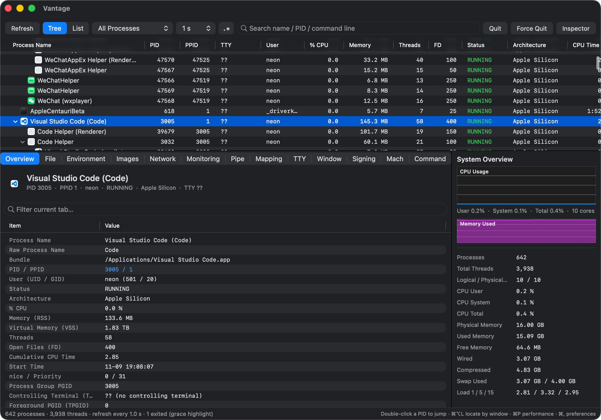
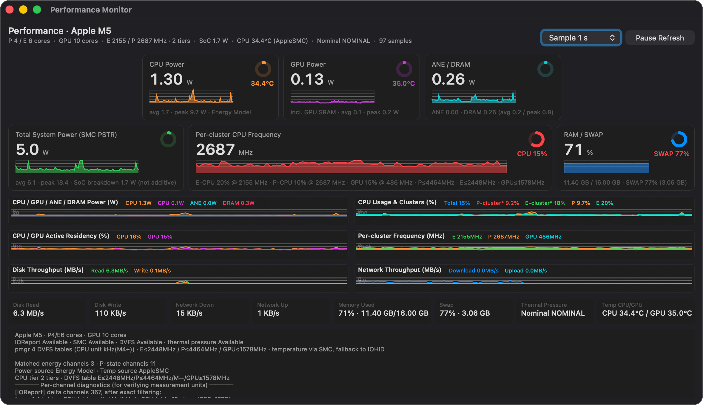
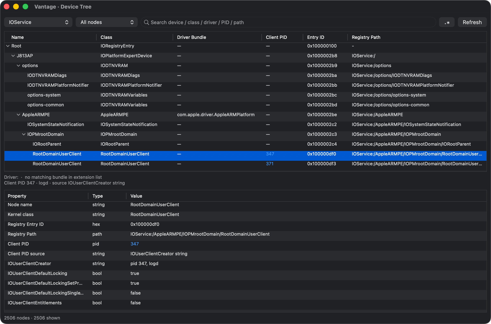
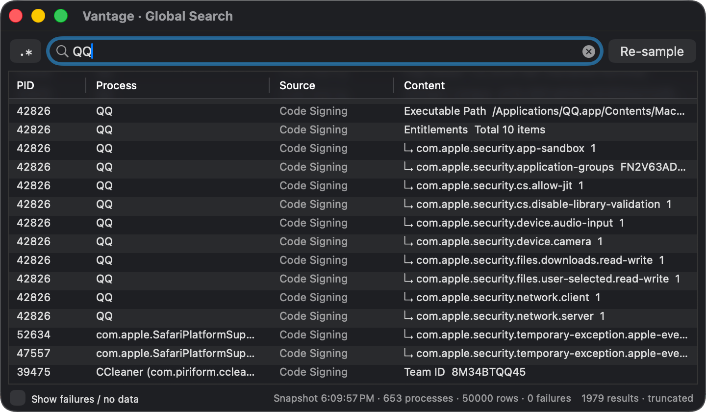
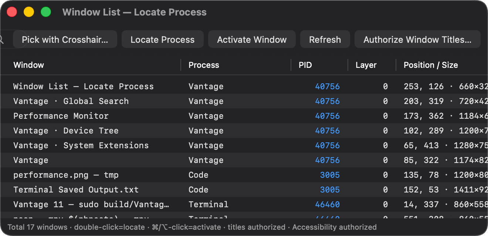

# Vantage


**Vantage** 是一个 macOS 原生 GUI 进程管理器与系统监控工具，用 **C（系统采集）+
Swift / AppKit（界面）** 实现，功能定位参考 Activity Monitor，窗口定位等交互参考 System Informer。

[English README](README.md) · [实现与设计笔记](docs/IMPLEMENTATION.md) · [SDK 兼容性与已知限制](docs/COMPATIBILITY.md)



*树形进程列表（14 列均可排序），展开的 App Bundle，以及检查器「概览」页：
本地化应用名旁同时显示原始可执行文件名。*

---

## 它解决什么问题

macOS 上多数进程工具要么只到 `ps` 那一层，要么得靠 `sudo powermetrics` 才能看到功耗和频率。
Vantage 两者都不需要，且只是一个**可本地构建的单个 `.app`**（也可从 Releases 下载 DMG）：

- **不需要 root、不调用 `powermetrics`、不用 Electron。** 全部走 macOS SDK：
  `sysctl` / `libproc` / Mach / IOKit / CoreGraphics / Security.framework。
  功耗、温度、DVFS 数据来自运行时 `dlopen`/`dlsym` 动态解析的可选私有接口
  （`libIOReport`、`AppleSMC`、IOHIDEventSystem），拿不到就优雅降级显示「—」。
- **SIP 下照样工作。** 受保护进程的 `task_for_pid` 与 UID 无关、一律 `EPERM`，
  因此工程不依赖 task port：内存映射、镜像、审计令牌、CS flags、socket、pipe、
  TTY、代码签名都有无 task port 的替代路径。
- **检查器级细节按页惰性加载并缓存**，选中一个很重的 App 不会卡住界面。

## 功能速览

| 模块 | 内容 |
|---|---|
| 进程列表 | 树形 / 扁平、14 列三态排序、0.5–5 秒刷新、过滤、正则搜索、本地化名 + 原始可执行名、已退出进程高亮 |
| 检查器 | 13 个页签：概览、文件、环境、镜像、网络、监控、Pipe 对端、内存映射、TTY、窗口、签名、Mach、命令 |
| 信号 | 右键菜单 / 主菜单，31 个 Darwin 信号可配置显示（默认 12 个）、确认策略、暂停继续、`sample` 采样 |
| 性能监控（⌘P） | CPU/GPU/ANE/DRAM 功耗、整机功率（SMC `PSTR`）、CPU/GPU 温度、P-state residency 分簇频率、磁盘与网络吞吐、逐通道诊断 |
| 全局搜索（⌘⇧F） | 先冻结进程快照，再对所有进程逐页取样；结果可跳回对应页签与行 |
| 设备树（⌘⌥B） | IORegistry 7 个 plane、驱动 Bundle、client PID、完整属性表 |
| 系统扩展（⌘⌥E） | `.kext` / `.dext` / `.systemextension` / `.appex` 清单、加载状态、`IOKitPersonalities`、Team ID |
| 窗口工具 | 准星定位进程（⌘⌥L）、全局窗口列表、双击激活具体窗口、双击 PID 跨进程/跨页跳转 |
| 定制 | ⌘, 偏好：采集上限、缓存 TTL、刷新间隔、默认视图、信号、11 项配色 + 5 组预设；深色模式、中英切换、⌘C 复制行、⌘/⌥+单击 |

完整功能矩阵与数据来源见 [实现笔记](docs/IMPLEMENTATION.md)。

## 界面预览

### 性能监控（⌘P）



*CPU/GPU/ANE/DRAM 功耗、整机功率（SMC `PSTR`）、CPU/GPU 温度、P-state residency
分簇频率、磁盘与网络吞吐，以及用于核对数值口径的逐通道诊断。*

### 设备树（⌘⌥B）



*选中 `RootDomainUserClient` 节点：驱动 Bundle 查询、`IOUserClientCreator`
client PID，以及完整属性表。*

### 全局搜索（⌘⇧F）



*在冻结的进程快照上跨全部页签搜索，结果可跳回对应页签与行。*

### 窗口列表



*列出屏幕上的全部窗口及其 owner PID、层、位置尺寸。双击定位进程，
⌘/⌥+单击激活该窗口。*

## 运行环境

- **macOS 12 (Monterey) 及以上**；功耗 / DVFS 数据建议 Apple Silicon
- **Xcode Command Line Tools**（Swift 5.9+）：`xcode-select --install`
- 仅在需要重新生成本地化资源或图标集时才需要 Python 3

Intel Mac 与虚拟机可用，但没有 IOReport Energy Model 和 pmgr DVFS 表，功耗与频率显示「—」，
公开层的 CPU / 内存 / 磁盘 / 网络指标不受影响。

## 编译与运行

```bash
git clone https://github.com/nanacaret/Vantage.git
cd Vantage

swift build -c release          # 全新目录约 20 秒
swift run                       # 调试运行，不生成 .app

./Scripts/build_app.sh          # 生成 build/Vantage.app
open build/Vantage.app
```

`Scripts/build_app.sh` 会组装 bundle（`Packaging/Info.plist`、`Resources/*.lproj`、由
`iconutil` 生成的 `Assets/Vantage.icns`）
并做 ad-hoc 签名，全程不需要 root。同一目录内增量编译通常 1–3 秒。

> **Bundle ID**：`io.github.nanacaret.Vantage`。若以其他域名分发，可替换成自己的反向域名标识。
> 注意改 ID 会让已保存的偏好、配色、列宽与窗口位置重置一次。

## 预构建 DMG

每次 push 到 `main` 都会重建滚动的 **[Nightly](https://github.com/nanacaret/Vantage/releases/tag/nightly)**
预发布；push `v*` tag 会创建带版本号的正式 Release。两者都附上 DMG 与 SHA-256 校验文件。
Pull request 同样会构建 DMG，只是上传为 Actions artifact（保留 14 天）。

CI 产物是 **ad-hoc 签名、未公证**的（GitHub Actions 里没有 Developer ID 证书）。
首次打开被 Gatekeeper 拦截时，右键 `Vantage.app` → **打开**，或在
「系统设置 → 隐私与安全性」中允许。打开前建议先校验：

```bash
shasum -a 256 -c Vantage-*.dmg.sha256
```

想完全从源码构建见 [编译与运行](#编译与运行)；工作流在
[.github/workflows/build.yml](.github/workflows/build.yml)。

## 权限说明

Vantage **不需要 root**，部分功能需要用户授权的 TCC 权限：

| 权限 | 用途 | 未授权时 |
|---|---|---|
| 辅助功能 | 激活指定窗口 | 退化为只定位进程，其余功能不受影响 |
| 屏幕录制 | 「窗口」页 / 窗口列表里的**窗口标题** | 标题显示占位文字，窗口号、层、位置尺寸、Z 序、PID 仍可见 |
| 无 | 进程列表、所有详情页、设备树、扩展列表、性能公开层 | — |

辅助功能与屏幕录制是**两项独立授权**。发送信号走 `kill(2)`，同用户即可，无需提权。

SIP 开启时，受保护进程的 `task_for_pid` / `processor_set_tasks` 即使用 root 也返回 `EPERM`。
Vantage 会改用 `PROC_PIDREGIONINFO` + `proc_regionfilename`、
`task_name_for_pid` + `TASK_AUDIT_TOKEN`、以及 `csops` 读取 CS flags。详见
[实现笔记](docs/IMPLEMENTATION.md)。

## 架构

```
Sources/CProc/     C 采集层：扁平标量结构 + \t 分隔文本行
  proc_collect.c   全量进程/系统快照、CPU 差分、TTY
  proc_detail.c    单进程详情、socket、pipe、region、csops、签名
  ioreg.c          IORegistry 树、驱动 Bundle、client PID（只输出 ASCII 结构行）
  perf.c           采样线程：IOReport / SMC / DVFS / 公开计数器
  cproc_config.c   偏好下发的运行时 limits

Sources/Vantage/  Swift + AppKit 界面（只通过标量 accessor 访问 C 层）
Resources/        en.lproj / zh-Hans.lproj Localizable.strings
Tools/            生成器（i18n 主表、C 层双语表、图标构建）
Assets/           App Icon（PNG 主图、.iconset、.icns）
```

C 层刻意只暴露**扁平标量结构与 `\t` 分隔文本行**，Swift 侧因此不必处理被导入成 tuple 的
`char[]` 数组。每次 `proc_pidfdinfo` 都按 `PROC_PID*INFO_SIZE` 分配缓冲区；私有符号一律运行时解析，
不做链接期依赖。

## 国际化

界面文案使用**语义 key**（`L("list.processName")`），中文与英文都是 `.strings` 里的 value，
不是 key。语言可在运行时切换（⌘, → 通用 → 界面），无需重启。

改文案请编辑 `Tools/l10n_master.py` 后重新生成：

```bash
python3 Tools/build_l10n.py
```

一次重建两张 `.lproj`、内嵌兜底表、强类型 key 常量与 C 层双语表。生成器输出是**确定的**，
连续运行两次不会产生 diff。生成文件带 SPDX 头且已入库，所以 `swift build` 不依赖 Python。

## 文档

| 文档 | 内容 |
|---|---|
| [README.md](README.md) | English |
| [docs/IMPLEMENTATION.md](docs/IMPLEMENTATION.md) | 数据来源、统计口径、SIP 替代方案、各窗口实现取舍 |
| [docs/COMPATIBILITY.md](docs/COMPATIBILITY.md) | SDK 差异、构建约束、已知限制、可定制点 |
| [docs/PUBLISHING.md](docs/PUBLISHING.md) | 新建仓库初始化清单 |
| [CONTRIBUTING.md](CONTRIBUTING.md) | 贡献指南 |
| [THIRD_PARTY_NOTICES.md](THIRD_PARTY_NOTICES.md) | 参考与致谢 |
| [.github/workflows/build.yml](.github/workflows/build.yml) | CI：编译、DMG、nightly / tag Release |
| [Scripts/make_dmg.sh](Scripts/make_dmg.sh) | 本地 DMG 打包（`hdiutil`，无第三方工具） |

## 已知限制与免责声明

- 私有接口（`libIOReport` 通道、AppleSMC 键、`_AXUIElementGetWindow`、
  `syscall(SYS_csops, …)`）**没有公开文档，任何 macOS 版本都可能变更或移除**。
  拿不到数据显示「—」，绝不用 0 冒充。
- 本项目**不适用于 Mac App Store**（使用私有 API、ad-hoc 签名、
  `com.apple.security.cs.debugger` entitlement），也未做公证 —— CI 产出的 DMG 同样如此，
  见 [预构建 DMG](#预构建-dmg)。
- 功耗数值不是经过标定的测量仪器；分簇利用率是按核心序号的启发式分组；
  网络计数器是 32 位差分。请当作诊断参考，不要当作精确真值。
- SIP 下读取其他进程的内存字节没有公开替代方案，工程不做此尝试。
  Energy Model 分项与 SMC `PSTR` 整机功率口径不同，不可相加。
- 完整列表见 [SDK 兼容性与已知限制](docs/COMPATIBILITY.md)。

## 参与贡献

欢迎提 Issue 与 PR，见 [CONTRIBUTING.md](CONTRIBUTING.md)。报 bug 时请附上
macOS 版本、SDK / Xcode 版本、芯片架构与相关控制台输出或逐通道诊断文本。

## 致谢

Vantage 仅**参考思路与交互设计**：Activity Monitor（Apple）、
[System Informer](https://github.com/winsiderss/systeminformer)（MIT）、
[macmon](https://github.com/vladkens/macmon)，并依据 Apple 文档与 xnu 开源头文件核对系统调用语义。

## 许可证

[MIT](LICENSE) © 2026 nanacaret。所有源文件带
`SPDX-License-Identifier: MIT` 标识，生成文件由生成器模板继承。
